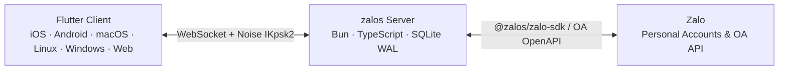

# zalos

**zalos** is a self-hosted, multi-device and multi-account Zalo proxy and cross-platform Flutter client. It lets you use one Zalo account across multiple devices—and manage multiple personal Zalo and Official Accounts (OA) from one app—with mutually authenticated Noise transport and client-held HPKE encryption at rest.



> **New to the codebase?** Start with the developer onboarding guide:
> [English](docs/onboarding/en/README.md) · [Tiếng Việt](docs/onboarding/vi/README.md).

---

## Features

### Multi-Account & Cross-Device
- **Personal & Official Accounts (OA):** Run multiple personal Zalo accounts (QR login with automatic cookie rotation) alongside Zalo Official Accounts in one interface with an instant account switcher.
- **Multi-Device Sync:** Connect phones, tablets, desktops, and web browsers simultaneously; messages, read receipts, reactions, typing indicators, and conversation state stay in sync across devices.
- **Device Management & RBAC:** Role-based device pairing (`admin` vs. `member`), per-device account ACLs (empty by default for new members), instant live revocation, and `zalos devices audit-acl` CLI auditing.
- **Base64url Pairing URIs & QR Onboarding:** Compact single-use `zalos://pair?d=<base64url>` pairing links and QR codes with server static-key pinning.

### Messaging & Rich Media
- **Core Messaging:** Real-time 1:1 and group chat, replies/quotes, `@mentions` (including `@All`), rich text formatting (bold, italic, underline, strikethrough), urgency markers (Important / Urgent), per-message self-destruct TTL, forward, recall, delete for me, and group admin delete for everyone.
- **Media & Stickers:** Images, videos, files (up to 100 MiB streaming), voice message recording & playback, link previews, contact cards, bank transfer cards, quick messages, and a full animated/sprite sticker picker with category dock and long-press preview.
- **History & Search:** Local SQLite persistence with paginated older history, in-conversation search, and shared media/files/links galleries.

### Voice & Video Calls
- **1:1 Voice and Video Calls with Zalo users:** Place and answer calls from any zalos client. The server speaks Zalo's ZRTC call protocol and bridges media to WebRTC (Opus audio, H.264 video), with hold, mute, camera switch and media switching.
- **Multi-Device Ringing:** Every device of the account rings; the first to answer takes the call and the others stop ringing.

### Group Productivity & Pinning
- **Pinned Messages & Pin Bar:** Pin and unpin messages in both **1:1 chats** and **groups**, with a live pinned banner below the chat header, jump-to-message navigation, and real-time sync (`board.updated`).
- **Group Board (Bảng tin):** Unified modal & conversation info view separating active pins and the full group board.
- **Polls (Bình chọn):** Create group polls (multi-choice, allow adding options, hide vote preview until voted, anonymous voting, pin to top), vote/unvote live, add new options, share polls, and lock/close polls.
- **Group Notes (Ghi chú):** Create, edit, and pin/unpin group notes directly from the composer, board, or group info pane.
- **Reminders (Nhắc hẹn):** List, create, edit, and remove one-time or recurring reminders (daily, weekly, monthly) in both 1:1 conversations and groups.

### Contacts, QR & Organization
- **Contacts & Friend Discovery:** Search users by phone number or Zalo username, send/accept/reject/cancel friend requests, view suggestions, manage aliases, block/unblock, and view online presence / last seen.
- **Zalo QR Scanner:** Built-in camera QR scanner supporting both zalos device pairing codes and Zalo user/group/link QR codes.
- **Conversation Organization:** Pin/mute conversations, custom color labels, archive/unarchive, hidden conversations with PIN management, per-conversation auto-delete timers, and linked Zalo companion devices view.

### Security & Privacy
- **Mutual Noise Transport:** `Noise_IKpsk2_25519_ChaChaPoly_BLAKE2s` implemented in Rust (`crates/zalos-noise`), bound to channel routes and pinned to the server static key.
- **Client-Held HPKE Vault:** Message bodies and cached media are sealed at rest (`RFC 9180` X25519/HKDF-SHA256/ChaCha20-Poly1305 in `crates/zalos-vault`) with atomic, resumable cutover, versioned key rotation (`vault.rotate`), and explicit memory zeroization (`zeroize`).
- **Step-Up Auth & Local Hygiene:** Biometric/passcode step-up (`local_auth`) before recovery-code export, pairing creation, device revocation, or hidden-PIN reset; conditional 60-second clipboard auto-clear; randomized `0600` temporary media with automatic cleanup.
- **Hardened Server & Egress:** Connection-time DNS-pinned SSRF guard (prevents DNS rebinding and HTTPS→HTTP downgrade), optional strict Zalo/CDN egress allowlist, durable hash-checked idempotency, aggregate connection/RPC/upload quotas and rate limiting, structured secret-redacting audit logs, fail-closed Tailscale Funnel verification, and non-root read-only Docker containers.

---

## Repository Layout

| Path | Description |
|---|---|
| `crates/zalos-noise` | Rust Noise protocol wrapper (`snow`), compiled to WASM (server/web) and native (Flutter via FRB). |
| `crates/zalos-vault` | Rust RFC 9180 HPKE vault sealing, versioned key derivation, and `zeroize` secret handling. |
| `server/` | Bun + TypeScript server (`ws`, `bun:sqlite`, `@zalos/zalo-sdk` personal-account gateway, OA OpenAPI gateway, voice/video call gateway, CLI & `doctor`). |
| `packages/zalo-sdk` | `@zalos/zalo-sdk`, the internal Zalo Web/PC protocol client used by the server. |
| `client/` | Cross-platform Flutter client (iOS, Android, macOS, Linux, Windows, Web). |
| `landing/` | Marketing site (Next.js + shadcn). |
| `deploy/` | Hardened Docker Compose (`compose.yaml`, `compose.sidecar-ro.yaml`, `compose.local.yaml`) and systemd unit. |
| `docs/` | [Onboarding](docs/onboarding/en/README.md), [DESIGN.md](docs/DESIGN.md), [SECURITY_ARCHITECT.md](docs/SECURITY_ARCHITECT.md) and [ZALO_SDK_AND_CALLS.md](docs/ZALO_SDK_AND_CALLS.md). |
| `.github/workflows/` | SSDF CI pipeline (security test gate, OSV-Scanner, Cargo Audit, Gitleaks, CycloneDX SBOM). |

---

## Quick Start

### 1. Deploy Server with Docker + Tailscale Sidecar (Recommended)

```bash
cd deploy/docker
cp .env.example .env   # set TS_AUTHKEY and TS_HOSTNAME
docker compose up -d --build

# Generate the first admin pairing URI / QR code
docker compose exec zalos zalos pair --role admin
```

The image also builds and ships the Flutter web client, served on the same port at `http://<host>:7443/`.
The web client needs a secure context for SharedArrayBuffer: use `http://127.0.0.1` in local mode or put the service behind HTTPS (for example `tailscale serve --https=443 http://127.0.0.1:7443` or any TLS reverse proxy).
Plain `http://100.x.y.z` over the tailnet is not cross-origin isolated.
Expect the first Docker build to be slow because it compiles the Rust wasm bundle and Flutter web client.

To keep Tailscale's control socket isolated from the app container, layer the read-only overlay:

```bash
docker compose -f compose.yaml -f compose.sidecar-ro.yaml up -d
```

### 2. Local Container Mode (Host Tailscale or Loopback)

```bash
cd deploy/docker
ZALOS_BIND_HOST=127.0.0.1 ZALOS_PUBLIC_HOST=127.0.0.1 \
  docker compose -f compose.local.yaml up -d --build

docker compose -f compose.local.yaml exec zalos zalos pair --role admin
```

### 3. Run the Flutter Client

```bash
cd client
flutter pub get
flutter run
```

Scan or paste the pairing URI from step 1/2, then log in to your personal Zalo account (QR) or add an Official Account from **Me → Accounts**.

---

## Development & Verification

```bash
# Rust crypto crates
cargo test -p zalos-noise -p zalos-vault

# Server typecheck & tests
cd server && bun install --frozen-lockfile && bunx tsc --noEmit && bun test

# Flutter client analysis & tests
cd client && flutter analyze && flutter test
```

See [docs/DESIGN.md](docs/DESIGN.md) for protocol details and [docs/SECURITY_ARCHITECT.md](docs/SECURITY_ARCHITECT.md) for the full threat model, security controls, and residual risks.
