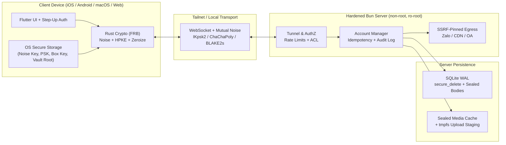
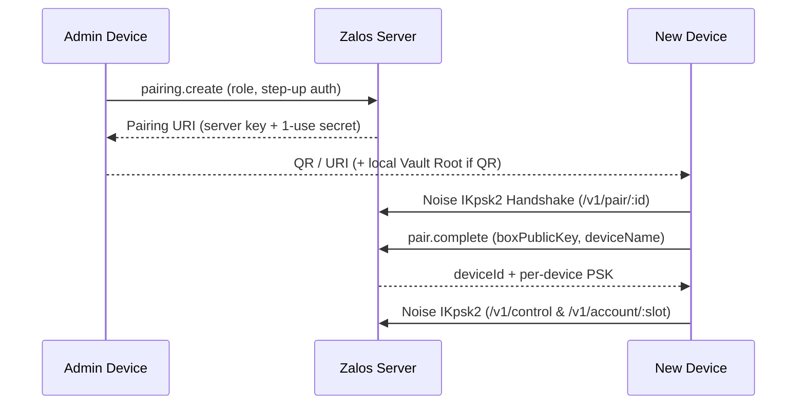
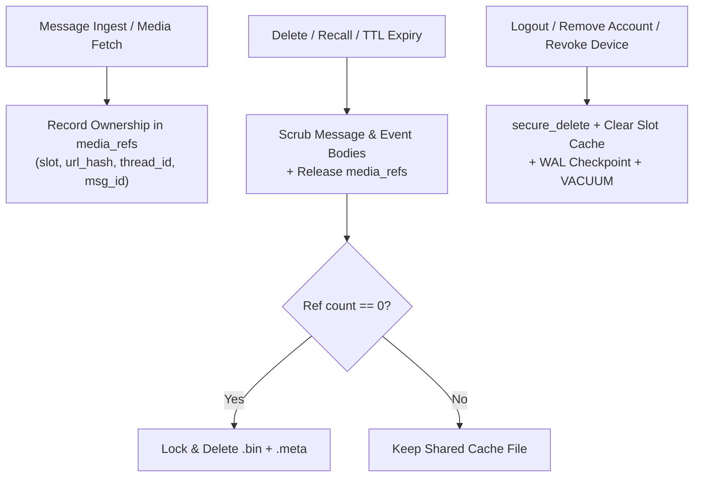

# Zalos Security Architecture

This document describes the security architecture, trust boundaries, controls, and residual risks of **zalos** across its Rust cryptographic crates, Bun/TypeScript server, Flutter clients, and Docker/systemd deployments.

## 1. Security Model & Trust Boundaries

Zalos is a self-hosted, multi-device bridge to Zalo. The server maintains active Zalo sessions for unattended sync and message delivery, while historical message bodies and cached media are sealed at rest to **client-held keys** that the server never possesses.

### Design Invariants
- **Confidentiality in transit:** Every client-to-server channel is mutually authenticated and encrypted using Noise (`Noise_IKpsk2_25519_ChaChaPoly_BLAKE2s`) with server static-key pinning, independent of whether Tailscale is present.
- **Confidentiality at rest (history):** Message bodies and cached media are sealed with client-derived HPKE public keys (`RFC 9180`). A compromised disk, database backup, or offline snapshot does not reveal sealed history.
- **Least privilege:** New member devices start with **empty** account ACLs; administrative and vault lifecycle controls are strictly admin-bound.
- **Clear operational metadata:** Thread IDs, message IDs, timestamps, sender IDs, unread counters, reactions, labels, and minimal Zalo references remain clear so the server can route, order, sync, react, recall, and delete.

---

## 2. Transport Security & Pairing

- **Protocol:** `Noise_IKpsk2_25519_ChaChaPoly_BLAKE2s` implemented in `crates/zalos-noise` over `snow`.
- **Route binding:** Every channel binds its route into the Noise prologue (`zalos/1/pair/<id>`, `zalos/1/control`, `zalos/1/account/<slot>`), preventing cross-channel replay.
- **Server identity pinning:** Pairing URIs (`zalos://pair?d=<base64url>`) carry the server's 32-byte static public key, a 32-byte single-use pairing secret (10-minute default TTL), host, and port.
- **Device credentials:** Completing `pair.complete` transactionally consumes the pairing token, creates the device record, and issues a unique 32-byte per-device PSK.
- **Pre-auth uniform errors:** Unknown routes, unknown slots, invalid pairings, and failed handshakes close uniformly with `4001` (`CLOSE_AUTH`) without leaking existence.

---

## 3. Authorization & Role-Based Access Control

Every RPC re-validates device revocation and ACL membership against SQLite on each request, backed by a 5-second background sweep that closes revoked or de-authorized sockets.

| Scope | Allowed Roles | Enforcement |
|---|---|---|
| Control admin RPCs (`devices.*`, `pairing.create`, `vault.claim`, `vault.setKey`, `vault.rotate`, `vault.requests.list`, `vault.grant`, `vault.reject`, `accounts.*`) | `admin` only | `requireAdmin(ctx)` returns `forbidden` with zero gateway/DB side effects and emits `authz.denied` audit event |
| Control device RPCs (`manifest.get`, `vault.request`, `vault.fetch`) | Authenticated device | Scoped to `deviceOf(ctx)` and its granted slots |
| Account channel RPCs (`/v1/account/:slot`) | Device holding explicit ACL for `slot` | Checked at Noise handshake (`resolvePsk`), on every RPC (`stillAllowed`), and on 5s sweep |

- **Fail-closed ACL defaults:** Newly paired `member` devices receive an empty ACL (`[]`). Adding a new personal or OA account grants implicit access only to `admin` devices, never expanding existing `member` ACLs.
- **ACL auditing:** Administrators can inspect legacy member grants via `zalos devices audit-acl`.

---

## 4. Vault Encryption at Rest & Key Agility

Implemented in `crates/zalos-vault` using **RFC 9180 HPKE** (`DHKEM(X25519, HKDF-SHA256)`, `HKDF-SHA256`, `ChaCha20-Poly1305`, base mode).

- **Key hierarchy:**
  - **Vault root:** 32 random OS bytes generated on the first admin device; never transmitted in plaintext to the server.
  - **Per-slot versioned keys:** Derived via HKDF-SHA256 with domain separation:
    - Generation 1 (`kv = 1`): `zalos/vault/1/<slot>`
    - Rotated generations (`kv >= 2`): `zalos/vault/2/<slot>/kv/<kv>`
  - **Root transfer:** Either out-of-band via local QR append, or via `vault.request` / `vault.grant` where the admin verifies the recipient's locally recomputed box-key fingerprint before HPKE-wrapping the root with device-ID AAD.
- **Atomic, resumable cutover (`vault.setKey`):**
  1. Serialized per slot via `withMediaCacheLock`.
  2. All cached media is sealed to `.sealing` staging files and `fsync`ed before touching the database.
  3. One SQLite transaction installs `vault_public_key`, sets `vault_state = 'migrating'`, and seals all historical message rows and nested event payloads.
  4. Staged ciphertext and metadata are atomically renamed with `fsync`, plaintext backups are deleted, and `vault_state` transitions to `'sealed'`.
  5. Concurrent downloads re-check `getVaultKey()` under the lock immediately before publication; startup `resumeVaultMigrations()` automatically completes any interrupted cutover.
- **Versioned key rotation (`vault.rotate`):** Admin-only compare-and-set RPC increments `vault_key_version` and installs the new public key so all subsequent messages and media seal under `kv + 1` while older records remain tagged with their original `kv`.
- **Memory zeroization:** Private keys, HKDF intermediate keying material, and Noise handshake hashes inside `zalos-vault` and `zalos-noise` are explicitly wiped on drop via `zeroize`.

---

## 5. Data Lifecycle & Deletion

- **SQLite hygiene:** `PRAGMA secure_delete = ON` is enabled on database open. Revocation, logout, vault reset, and account removal scrub credentials/keys and run `VACUUM` + WAL `TRUNCATE` checkpoint.
- **Deterministic media cleanup:** `media_refs` tracks per-message URL ownership so deleting a message, recalling it, or expiring it via conversation/message TTL deletes exact `<sha256(url)>.bin` and `.meta` files once no live message references them.
- **Ephemeral upload staging:** Inbound encrypted upload blobs are staged under `ZALOS_UPLOAD_TMP_DIR` (backed by size-bounded `tmpfs` in Docker) and unlinked on consumption, channel close, quota eviction, or upload timeout.

---

## 6. Resource Governance, Idempotency & Egress Protection

### Aggregate Resource Limits
- **Server tunnel (`server/src/tunnel/server.ts`):** Caps global connections (`128`), per-device connections (`16`), per-channel (`32`) and per-device (`64`) in-flight RPCs, unclaimed uploads per channel (`8`), per-device upload bytes (`250 MiB`), and enforces disk headroom checks (`128 MiB` minimum free) plus per-device token-bucket rate limits for media/sticker and send RPCs.
- **Streaming media & timeouts:** Both direct downloads and `ZcaGateway.fetchMediaToFile` enforce connect (`20s`) and overall (`120s`) deadlines, cancel bodies on error, cap payloads at `100 MiB`, and stream directly to disk rather than buffering full copies in RAM.
- **Client framing (`frame_codec.dart`, `noise_channel.dart`):** Caps open inbound streams (`32`), total buffered reassembly bytes (`64–128 MiB`), and unclaimed blob memory (`32 MiB` / `128` items FIFO).

### SSRF & Egress Protection
- **Connection-time DNS pinning:** `pinnedHttpFetch` validates every resolved IP inside the socket `lookup` callback using `ipaddr.js` (unwrapping IPv4-mapped, compatible, 6to4, NAT64, and RFC 6145 forms and blocking loopback, RFC 1918, CGNAT/Tailscale, link-local, and site-local ranges), eliminating two-stage DNS rebinding TOCTOU.
- **Protocol & redirect hygiene:** Redirects are manual (max 5 hops), every hop is revalidated, and `HTTPS → HTTP` downgrades are refused unconditionally.
- **Hybrid egress mode:** Allows HTTPS to public hosts (for external link previews) while restricting Zalo session cookies strictly to recognized Zalo hosts; setting `ZALOS_MEDIA_ALLOWLIST_ONLY=1` locks outbound media strictly to Zalo/CDN domains.

### Durable Idempotency
- Every send method (including `sendBankCard`) serializes through SQLite `idempotency_keys` and an in-flight map keyed by `(slot, cli_id)` with a canonical SHA-256 `request_hash`.
- Matching retries return the original result without re-calling Zalo; reusing a `cli_id` with a different method, destination, or payload is rejected with `conflict`.

---

## 7. Credential Hygiene, Audit Logging & Deployment Hardening

- **OA credentials:** Official Account `access_token` values are transmitted strictly in HTTP headers, never in URL query strings.
- **Redacting error logger & security audit events (`server/src/security/audit.ts`):** Unexpected errors pass through recursive redaction stripping tokens, cookies, PINs, PSKs, secrets, and message bodies. Security-relevant actions (`auth.ok`, `auth.fail`, `authz.denied`, `pair.complete`, `device.revoke`, `acl.update`, `vault.*`, `account.*`) emit structured UTC JSON audit records without message content.
- **Production vs. dev/mock fail-closed guards:**
  - `--fake` is refused outside `--dev`; `ZALOS_ZALO_MOCK_URL` is refused outside `--dev`/`--local`.
  - `createZalosServer` independently enforces `allowDev` at the composition root.
  - The dev-only loopback inject hook requires a per-run random 32-byte `X-Zalos-Inject-Token` stored in a `0600` file.
- **Doctor & Tailscale verification (`server/src/doctor.ts`):**
  - Structurally parses `tailscale funnel status --json` and **fails closed** on non-zero exit codes, invalid JSON, or Funnel exposure of the server port.
  - Enforces container sandbox invariants (`NoNewPrivs=1`, `CapEff=0`, read-only `/`) and systemd sandbox directives as critical checks.
- **Supported Container Topologies:**
  - **Tailscale Sidecar (`deploy/docker/compose.yaml`):** Non-root UID `10001`, `read_only: true`, `cap_drop: [ALL]`, `no-new-privileges:true`, `mem_limit: 512m`, `pids_limit: 256`, `cpus: "1.0"`, and `tmpfs: /tmp:size=128m,noexec,nosuid,mode=0700` for `ZALOS_UPLOAD_TMP_DIR`. Pair with `deploy/docker/compose.sidecar-ro.yaml` to avoid mounting `tailscaled.sock` inside the app container.
  - **Host-Tailscale / Local Container (`deploy/docker/compose.local.yaml`):** Same container hardening (`ro`, `cap_drop: ALL`, `pids_limit`, `cpus`, bounded `/tmp` tmpfs) with host-bound port publishing (loopback or host Tailscale IP).

---

## 8. Client Secret Lifecycle

- **Secure storage (`key_store.dart`):** Device keys, PSK, box key, and vault root are stored via OS secure storage (`KeychainAccessibility.first_unlock_this_device` on iOS, `usesDataProtectionKeychain: kReleaseMode` on macOS, hardware-backed keystore ciphers on Android).
- **Step-up authentication (`local_auth`):** Biometric or device passcode verification is required before revealing/exporting the recovery code, creating pairing offers, revoking devices, or resetting the hidden-conversation PIN.
- **Clipboard hygiene:** Copied pairing codes and recovery codes auto-clear after 60 seconds (or on dialog close) only if the clipboard still holds that exact secret.
- **Temporary decrypted media (`native_io.dart`):** Materialized with cryptographically random 128-bit filenames under `0700`/`0600` permissions and purged on app startup and unpair.
- **Platform hardening:**
  - **Android:** `allowBackup="false"`, `fullBackupContent="false"`, backup exclusion rules (`data_extraction_rules.xml`), and scoped `network_security_config.xml` (no global cleartext traffic).
  - **Web (`scripts/serve-web.sh`):** Sets COOP, COEP, `Cache-Control: no-store`, `X-Frame-Options: DENY`, `X-Content-Type-Options: nosniff`, `Referrer-Policy: no-referrer`, and a strict `Content-Security-Policy`.

---

## 9. SSDF & Continuous Security Verification

Automated in `.github/workflows/security.yml` on every push to `main`, pull request, and weekly schedule (`cron: "0 3 * * 1"`):
- **Security & Cryptography Gate:** Runs `cargo test -p zalos-noise -p zalos-vault --locked` and the full server security test suites (`security`, `security-architecture`, `security-phase2`, `pairing`, `vault-integ`, `zca-hardening`, `review-fixes`, `doctor`, `local-mode`, `upload-staging`).
- **Vulnerability & Secret Scanning:** Runs `osv-scanner` over `server/bun.lock`, `Cargo.lock`, and `client/pubspec.lock`, `cargo audit` on Rust crates, and `gitleaks` across git history.
- **SBOM & Artifact Integrity:** Generates CycloneDX JSON SBOMs (`zalos-sbom.cdx.json`) and `SHA256SUMS.txt` on every build.

---

## 10. Residual Risks

The following inherent limitations remain by design and must stay visible to operators:

1. **Live server compromise:** Because the server terminates Noise and maintains active Zalo sessions, an attacker with live code execution on the server or root on the host can observe messages passing through in real time and access stored Zalo credentials.
2. **Clear metadata:** Thread names, participant IDs, timestamps, unread counts, reactions, labels, and Zalo message references are intentionally stored unsealed for indexing and protocol actions.
3. **Root loss equals history loss:** Losing every device holding the vault root and the recovery code renders sealed history permanently unreadable.
4. **Transport revocation vs. prior ciphertexts:** Revoking a device immediately blocks future server access and `vault.rotate` protects future records, but cannot retroactively un-decrypt ciphertexts a compromised device already copied alongside the old root.
5. **Physical storage erasure:** SQLite `secure_delete`, `VACUUM`, WAL truncation, and file unlinking clean live files but cannot recall SSD wear-leveling blocks, copy-on-write snapshots, backups, screenshots, notifications, or Zalo's own remote copies.
6. **Managed-runtime memory:** Rust `zeroize` wipes native secret buffers, but garbage-collected runtimes (Dart, JS, WASM) and OS clipboards cannot guarantee deterministic memory erasure.
7. **Web client assurance:** Web storage relies on `localStorage` for its wrapping key; any origin XSS compromises local credentials and vault history. Native clients remain the recommended high-assurance platform.
8. **Out-of-band fingerprint verification:** Vault root approval depends on the human admin genuinely comparing the displayed fingerprint before confirming.
9. **Hidden conversations PIN:** Zalo does not expose a local PIN verification API; the hidden gate is a visibility prompt rather than a cryptographic lock, while PIN reset is guarded by device step-up authentication.
