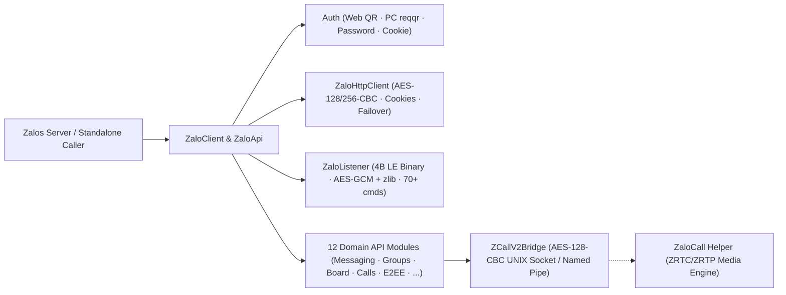
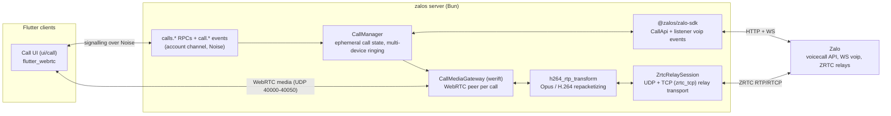

# `@zalos/zalo-sdk` and voice/video calls

This document describes the internal `@zalos/zalo-sdk` package
(`packages/zalo-sdk`), the TypeScript client zalos uses for every interaction
with Zalo, and how voice and video calls are carried between Zalo and the
zalos clients.

---

## 1. `@zalos/zalo-sdk` overview and protocol coverage

`@zalos/zalo-sdk` is a standalone, zero-bloat TypeScript implementation of the complete Zalo Web & Zalo PC (`26.10.20`) wire protocol using Node/Bun native crypto (`node:crypto`, `node:zlib`) and minimal dependencies (`ws`, `tough-cookie`, `json-bigint`, `image-size`).

### Module Structure (`packages/zalo-sdk/src/`)

| Path | Responsibility |
|---|---|
| `core/crypto.ts` | Session AES-128/256-CBC (`encodeAES`/`decodeAES`), `ParamsEncryptor` (`zcid` / `zcid_ext` / derived `enk`), `computeSignKey`, `encryptPassword`, WS `encrypt=0/1/2/3` (`AES-GCM` + `zlib`), `zcall-v2` IPC AES-128-CBC hex codec, and `JSONBig` (`storeAsString: true`) for >53-bit Zalo IDs. |
| `core/cookies.ts` | `ZaloCookieJar` backed by `tough-cookie` with `Set-Cookie` multi-header ingestion (`getSetCookie`), multi-domain `zpw_sek` mirroring (`zaloapp.com`, `zalo.me`, `chat.zalo.me`), and `toJSON()` schema compatibility with `zalos` SQLite storage. |
| `core/http.ts` | Pluggable `fetch` (`polyfill` seam for tests/TLS proxy), `zpw_service_map_v3` domain failover (5-minute reset window), Web & PC header profiles, double-layer envelope unwrapping, multipart query-param encoding, and 30s serialized `SerializedQueue` for call signaling. |
| `auth/login.ts` & `auth/login-qr.ts` | Web QR login (`id.zalo.me` 7-step flow), native PC QR login (`wpa.zaloapp.com/api/login/reqqr`), password login (`loginByPasswv2` + `getCaptcha`), `getLoginInfo`, `getServerInfo`, `keepAlive`, `getListDevice`, and 3-step `logout`. |
| `ws/framing.ts` & `ws/listener.ts` | `[version:u8, cmd:u16le, subCmd:u8, ...utf8Json]` framing; `cmd=1/sub=1` cipher-key handshake; `cmd=2` & `cmd=4` keepalive pings; offline history/reaction/control/voip pulls (`510/511/610/611/603/604`); live `501/521/502/522/612/601/602`; brace-less `typing` parser; `voip` 60s staleness guard; async `file_done`/`video_done` upload callbacks; E2EE Signal `513..582`; kickout (`3000` / error `600`). |
| `apis/messaging.ts` | 22 methods: text/styles/mentions/urgency/quote/TTL, chunked multipart `uploadAttachment` + `asyncfile/msg` + `photo_original/send` + GIF `upthumb`/`gif`, voice/video/card/bank-card/sticker/link, forward, undo, delete, seen/delivered/typing, reaction, cloud history (`getCloudMessage`), preload. |
| `apis/groups.ts` | 31 methods: CRUD (`createGroup` POST query-param quirk, unencrypted `getAllGroups`), member & admin management, pending/blocked lists, join links, invite inbox, community upgrade, mutual friend groups. |
| `apis/board.ts` | 26 methods: polls, notes, 1:1 & group reminders, **and first-class 1:1 + group pin/unpin/reorder APIs** (`/api/friendboard/*`, `/api/board/pin*`, `/api/board/unpinv2`), eliminating all 6 pin-board `api.custom()` workarounds. |
| `apis/friends.ts` | 28 methods: friends, online presence, last online, close friends (`updateCloseFriend`), phone/username lookup, friend requests, aliases, block/unblock/`getBlockList`, QR fetch, abuse reports. |
| `apis/conversations.ts` | 18 methods: pin/mute/hide/PIN-reset/archive/unread-mark/auto-delete/labels/delete-chat. |
| `apis/stickers.ts` | 6 methods: sticker suggestions, detail, category detail, search, emoji status (`friends`, `resource-config`). |
| `apis/profile.ts` | 13 methods: account info, profile/bio/avatar/album update, account settings, active status ping/deactivate, language, focus state. |
| `apis/business.ts` | 24 methods: business profile, catalogs & products, quick messages (including `photoId`-preserving `updateQuickMessage`), auto-reply, bank config/accounts. |
| `apis/call.ts` | All **28** 1:1 & Group `/api/voicecall/*` signaling endpoints (`401..12447`), `logEndCall` retry schedule (`error_code === 112`), `/api/znoise` ID de-noising, QoS `uploadcalllog`, and `dispatchNativeSignal(command, data)`. |
| `apis/zcall-bridge.ts` | `ZCallV2Bridge`: dual UNIX-socket / named-pipe IPC bridge with AES-128-CBC hex framing, 4000-char chunking (`<slice>#<seq>#<total>#<idx>#$`) with ack flow control, `native-ready` queuing, and auto-binding to `ZaloListener` + `CallApi`. |
| `apis/e2ee.ts` | Full Signal Protocol WebSocket commands (`540..582`: PreKey bundles, X3DH session init, group sender keys, compatibility & upgrade/downgrade) + `chat_e2e`/`group_e2e` HTTP messaging endpoints. |
| `apis/extras.ts` | Media Store (`/api/mediastore/*`), My Cloud (`/api/media/oneone/*`), ZCloud/ZFamily viewer keys, Recent Search, Group ID encrypt/decrypt, mobile sync (`590..592`), backup (`630..634`), interactive files (`536..537`), and multi-site upload URL (`800`). |

---

---

## 2. Voice and video calls

1:1 voice and video calls work end to end between zalos clients and the
official Zalo apps. Zalo does **not** use WebRTC: calls are signalled over
`/api/voicecall/*` and the realtime WebSocket (`voip` commands), and media flows
through Zalo's proprietary **ZRTC** relays (custom RTP/RTCP framing, ZRTP
packets, Opus and H.264 payloads). zalos therefore terminates ZRTC on the
server and bridges media to standard WebRTC for the clients.

### 2.1 Signalling

- Client RPCs on the account channel: `calls.start {media: voice|video}`,
  `calls.accept`, `calls.reject`, `calls.hangup`, `calls.hold`,
  `calls.switchMedia`, `calls.shareScreen`, `calls.active` (re-queried after a
  reconnect or wake), and for groups `calls.groupJoin`, `calls.groupState`,
  `calls.groupAddUser`. `calls.zaloSignal` and `calls.resolveZNoise` expose the
  raw signalling helpers.
- Server events: `call.incoming`, `call.state`, `call.answeredElsewhere`,
  `call.ended`, `call.media.ice`, `call.voipSignal`.
- Call signalling is **ephemeral**: `server/src/accounts/call_manager.ts` keeps
  active calls in memory and broadcasts without a `seq`, so nothing is replayed
  from SQLite. The finished call reaches history as a normal call-log message.
- **Multi-device ringing**: every device of the account rings; `calls.accept`
  is an atomic compare-and-set, the first device wins and the others receive
  `call.answeredElsewhere`.

### 2.2 Media path

- `server/src/accounts/call_media_gateway.ts` creates one WebRTC peer
  connection per call (`werift`), answers the client's SDP offer and exchanges
  ICE candidates through `call.media.ice`. Server candidates are rewritten to
  `ZALOS_PUBLIC_HOST` and limited to the UDP range
  `ZALOS_RTC_PORT_MIN`..`ZALOS_RTC_PORT_MAX` (default 40000-40050), which the
  compose files publish. Extra ICE servers come from `ZALOS_ICE_SERVERS`.
- `server/src/accounts/zrtc_session.ts` speaks to the ZRTC relays returned by
  the call request (init call, relay and peer pings, request-forward, end call),
  over UDP or, when the relay asks for it, TCP (`zrtc_tcp.ts`, length-prefixed
  frames). Packet encoding lives in `zrtc_packet.ts`.
- Audio: Opus, Zalo payload type 112 at 16 kHz, mapped to WebRTC Opus at 48 kHz.
- Video: H.264, Zalo payload types 97 (delta) and 98 (keyframe), repacketized in
  both directions by `h264_rtp_transform.ts`. RTCP feedback (PLI, FIR, NACK,
  sender/receiver reports) is translated so either side can request keyframes.
- Codec negotiation data for Zalo (`extendData`, audio codec list) is built by
  the SDK (`buildZrtcExtendData`, `DEFAULT_ZRTC_AUDIO_CODECS`).

### 2.3 Client

- `client/lib/src/ui/call/call_media_controller.dart` owns the WebRTC session
  (`flutter_webrtc`): capture, offer, ICE, mute, camera switch, hold.
- `client/lib/src/ui/call/call_overlay.dart` renders incoming, outgoing and
  in-call UI on top of the shell.

### 2.4 Operating calls

- Publish the RTC UDP range from the container (`compose*.yaml` already map
  `40000-40050/udp`) and set `ZALOS_PUBLIC_HOST` to an address the clients can
  reach (the tailnet IP).
- Tests: `server/test/calls.test.ts`, `call_media_gateway.test.ts`,
  `zrtc_packet.test.ts`, `h264_rtp_transform.test.ts`, and the SDK's
  `packages/zalo-sdk/test/call.test.ts`.
