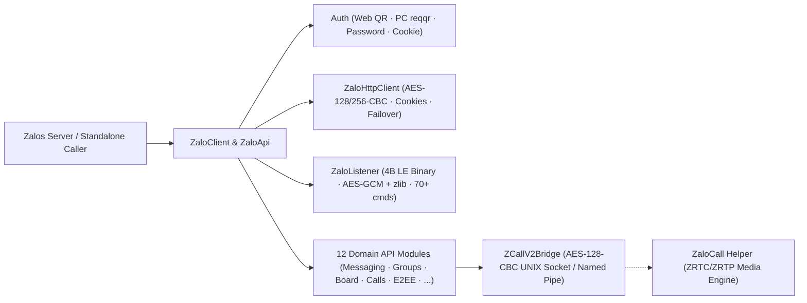
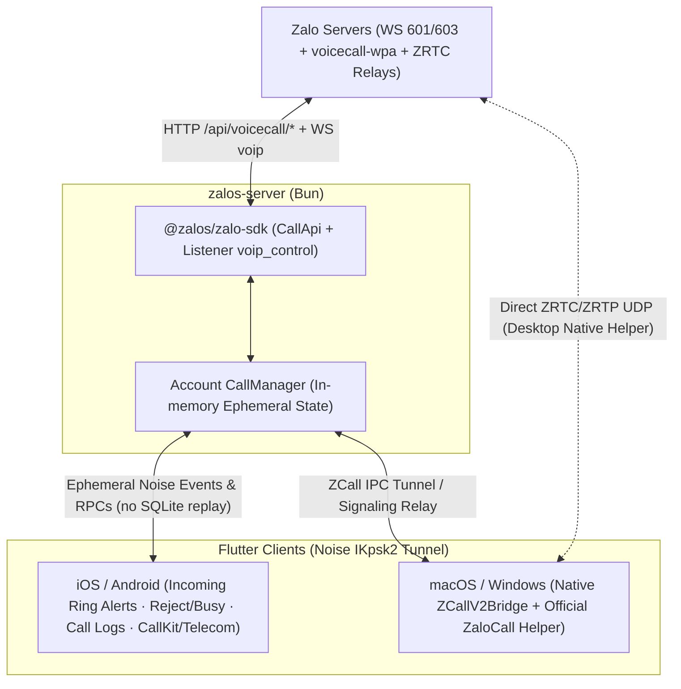

# `@zalos/zalo-sdk` Architecture, `zca-js` Migration Plan & Voice/Video Call Integration

This document defines the internal `@zalos/zalo-sdk` package (`packages/zalo-sdk`), the exact migration plan to replace and remove `zca-js` from `zalos-server`, and the technical blueprint for integrating Voice Call, Video Call, and Group Call across the `zalos` platform.

---

## 1. `@zalos/zalo-sdk` Overview & Protocol Coverage

`@zalos/zalo-sdk` is a standalone, zero-bloat TypeScript implementation of the complete Zalo Web & Zalo PC (`26.10.20`) wire protocol using Node/Bun native crypto (`node:crypto`, `node:zlib`) and minimal dependencies (`ws`, `tough-cookie`, `json-bigint`, `image-size`).

### Module Structure (`packages/zalo-sdk/src/`)

| Path | Responsibility |
|---|---|
| `core/crypto.ts` | Session AES-128/256-CBC (`encodeAES`/`decodeAES`), `ParamsEncryptor` (`zcid` / `zcid_ext` / derived `enk`), `computeSignKey`, `encryptPassword`, WS `encrypt=0/1/2/3` (`AES-GCM` + `zlib`), `zcall-v2` IPC AES-128-CBC hex codec, and `JSONBig` (`storeAsString: true`) for >53-bit Zalo IDs. |
| `core/cookies.ts` | `ZaloCookieJar` backed by `tough-cookie` with `Set-Cookie` multi-header ingestion (`getSetCookie`), multi-domain `zpw_sek` mirroring (`zaloapp.com`, `zalo.me`, `chat.zalo.me`), and `toJSON()` schema compatibility with `zalos` SQLite storage. |
| `core/http.ts` | Pluggable `fetch` (`polyfill` seam for tests/TLS proxy), `zpw_service_map_v3` domain failover (5-minute reset window), Web & PC header profiles, double-layer envelope unwrapping, multipart query-param encoding, and 30s serialized `SerializedQueue` for call signaling. |
| `auth/login.ts` & `auth/login-qr.ts` | Web QR login (`id.zalo.me` 7-step flow), native PC QR login (`wpa.zaloapp.com/api/login/reqqr`), password login (`loginByPasswv2` + `getCaptcha`), `getLoginInfo`, `getServerInfo`, `keepAlive`, `getListDevice`, and 3-step `logout`. |
| `ws/framing.ts` & `ws/listener.ts` | `[version:u8, cmd:u16le, subCmd:u8, ...utf8Json]` framing; `cmd=1/sub=1` cipher-key handshake; `cmd=2` & `cmd=4` keepalive pings; offline history/reaction/control/voip pulls (`510/511/610/611/603/604`); live `501/521/502/522/612/601/602`; brace-less `typing` parser; `voip` 60s staleness guard; async `file_done`/`video_done` upload callbacks; E2EE Signal `513..582`; kickout (`3000` / error `600`). |
| `apis/messaging.ts` | 22 methods: text/styles/mentions/urgency/quote/TTL, chunked multipart `uploadAttachment` + `asyncfile/msg` + `photo_original/send` + GIF `upthumb`/`gif`, voice/video/card/bank-card/sticker/link, forward, undo, delete, seen/delivered/typing, reaction, cloud history (`getCloudMessage`), preload. |
| `apis/groups.ts` | 31 methods: CRUD (`createGroup` POST query-param quirk, unencrypted `getAllGroups`), member & admin management, pending/blocked lists, join links, invite inbox, community upgrade, mutual friend groups. |
| `apis/board.ts` | 26 methods: polls, notes, 1:1 & group reminders, **and first-class 1:1 + group pin/unpin/reorder APIs** (`/api/friendboard/*`, `/api/board/pin*`, `/api/board/unpinv2`), eliminating all 6 pin-board `api.custom()` workarounds. |
| `apis/friends.ts` | 28 methods: friends, online presence, last online, close friends (`updateCloseFriend`), phone/username lookup, friend requests, aliases, block/unblock/`getBlockList`, QR fetch, abuse reports. |
| `apis/conversations.ts` | 18 methods: pin/mute/hide/PIN-reset/archive/unread-mark/auto-delete/labels/delete-chat. |
| `apis/stickers.ts` | 6 methods: sticker suggestions, detail, category detail, search, emoji status (`friends`, `resource-config`). |
| `apis/profile.ts` | 13 methods: account info, profile/bio/avatar/album update, account settings, active status ping/deactivate, language, focus state. |
| `apis/business.ts` | 24 methods: business profile, catalogs & products, quick messages (including `photoId`-preserving `updateQuickMessage`), auto-reply, bank config/accounts. |
| `apis/call.ts` | All **28** 1:1 & Group `/api/voicecall/*` signaling endpoints (`401..12447`), `logEndCall` retry schedule (`error_code === 112`), `/api/znoise` ID de-noising, QoS `uploadcalllog`, and `dispatchNativeSignal(command, data)`. |
| `apis/zcall-bridge.ts` | `ZCallV2Bridge`: dual UNIX-socket / named-pipe IPC bridge with AES-128-CBC hex framing, 4000-char chunking (`<slice>#<seq>#<total>#<idx>#$`) with ack flow control, `native-ready` queuing, and auto-binding to `ZaloListener` + `CallApi`. |
| `apis/e2ee.ts` | Full Signal Protocol WebSocket commands (`540..582`: PreKey bundles, X3DH session init, group sender keys, compatibility & upgrade/downgrade) + `chat_e2e`/`group_e2e` HTTP messaging endpoints. |
| `apis/extras.ts` | Media Store (`/api/mediastore/*`), My Cloud (`/api/media/oneone/*`), ZCloud/ZFamily viewer keys, Recent Search, Group ID encrypt/decrypt, mobile sync (`590..592`), backup (`630..634`), interactive files (`536..537`), and multi-site upload URL (`800`). |

---

## 2. Migration Plan: Dropping `zca-js` from `zalos-server`

### 2.1 Current Coupling Audit
Only **one** production file in `server/` imports `"zca-js"`:
- `server/src/gateway/zca.ts` imports `Zalo`, `ZaloApiError`, 14 runtime enums (`ThreadType`, `DestType`, `Urgency`, `TextStyle`, `Reactions`, `ChatTTL`, `MuteAction`, `MuteDuration`, `AvatarSize`, `ReportReason`, `BinBankCard`, `CloseReason`, `LoginQRCallbackEventType`, `FriendRecommendationsType`), and TS types.
- `server/src/server.ts` and `server/src/cli.ts` import `createZaloFactory` from `./gateway/zca.ts`.
- 7 server test files (`mock-seam.test.ts`, `zca.test.ts`, `zca-hardening.test.ts`, `phasec-gateway.test.ts`, `phased-gateway.test.ts`, `group-members.test.ts`, `real-account-followups.test.ts`) import enums or `encodeAES`/`decodeAES` from `zca-js`.

### 2.2 Mock Seam & SQLite Compatibility Guarantee
1. **Zero changes to `mock/`**: `ZaloClient` accepts `{ polyfill: mockGatewayFetch }` identically to `zca-js`. Every `/api/*` call uses the exact same query/form layout, `zpw_ver`, AES-128-CBC / `ParamsEncryptor` math, WebSocket `cmd=501..612` framing, and `file_done` async upload callback flow.
2. **Existing SQLite accounts stay valid**: `ZaloCookieJar.toJSON()` reads and writes `tough-cookie`'s `{ cookies: [...] }` schema, so existing `creds` blobs stored in `zalos.db` migrate without re-logging in.

### 2.3 Exact Step-by-Step Cutover
1. **Wire workspace dependency** in root/server `package.json`:
   - Add `"@zalos/zalo-sdk": "workspace:*"` (or relative import `"../../packages/zalo-sdk/src/index.ts"`) to `server/package.json`.
   - Update `deploy/docker/Dockerfile` (`COPY packages/zalo-sdk ./packages/zalo-sdk`) before `bun install --frozen-lockfile`.
2. **Swap imports in `server/src/gateway/zca.ts`**:
   - Replace `from "zca-js"` with `from "@zalos/zalo-sdk"`.
   - Delete `installQuickMessageUpdate()` and the 6 `api.custom("_pin*")` wrappers; call `api.business.updateQuickMessage(...)` and `api.board.{listGroupPins,pinGroupMessage,pinGroupBoardItem,unpinGroupTopic,createFriendPin,unpinFriendTopics}(...)` directly.
3. **Update test imports**:
   - In `server/test/mock-seam.test.ts`, import `{ decodeAES, encodeAES, ParamsEncryptor }` from `@zalos/zalo-sdk`.
   - In the 6 remaining `server/test/*.test.ts` files, swap `from "zca-js"` -> `from "@zalos/zalo-sdk"`.
4. **Remove `zca-js`**:
   - Delete `"zca-js": "2.3.0"` from `server/package.json`, run `bun install` in `server/` to regenerate `server/bun.lock`.
   - Drops legacy transitive dependencies (`crypto-js`, `pako`, `spark-md5`, `form-data`, older nested `ws` copy).
5. **Cutover Verification Gate**:
   - `cd packages/zalo-sdk && bun run typecheck && bun test`
   - `cd server && bunx tsc --noEmit && bun test`
   - `cd server && bun run test:e2e` (against untouched `mock/` Docker stack)
   - `docker compose -f deploy/docker/compose.local.yaml build` + smoke test.

### 2.4 Migration Risks & Mitigations
- **64-bit integer IDs (`> 2^53`)**: Mitigated via `JSONBig({ storeAsString: true })` in `core/crypto.ts`.
- **Real Zalo WS `encrypt=1/2/3`**: Unit-tested directly with real AES-GCM + zlib vectors in `packages/zalo-sdk/test/ws.test.ts` and `test/crypto.test.ts`.
- **GIF vs File extension routing**: Preserve `ZcaGateway`'s explicit attachment type handling when calling `api.messaging.sendMessage`.

---

## 3. Platform Architecture for Integrating Voice & Video Calls into `zalos`

### 3.1 Critical Protocol Reality: Zalo Uses Proprietary ZRTC/ZRTP (Not Standard WebRTC)
Reverse engineering Zalo PC (`26.10.20`) and Zalo Android (`libzrtc.so`) proved that **Zalo does NOT use WebRTC** (`RTCPeerConnection`, SDP, ICE/STUN/TURN, DTLS-SRTP):
- `401 /api/voicecall/requestcall` allocates proprietary UDP relay addresses (`servers: [{ rtpaddr, rtcpaddr }]`, ports `~8019-8020` / `4003-4004`), `sessId`, FEC lookup tables, and `zrtc_config`.
- Native `ZaloCall` (`com.vng.zalo.zalocall`) / Android `libzrtc.so` drives custom RTP/RTCP probing + ZRTP encryption + proprietary `codec`/`extendData` blobs exchanged over HTTP `GET /api/voicecall/*` and WS `cmd=601/603` (`act_type: "voip"`).
- **Engineering consequence**: A pure-TypeScript headless Linux server or browser WebRTC client cannot terminate live Zalo ZRTC audio/video media without either bridging to an official `ZaloCall` binary on desktop OR providing a separate Zalos-to-Zalos WebRTC channel.

### 3.2 Phased Platform Rollout Strategy

#### Tier 1: Server Call Signaling + Mobile Ring Alerts & Call Control (Works Everywhere, Pure TS/Dart)
1. **Ephemeral Noise Tunnel Signaling (`/v1/account/<slot>`)**:
   - Never append transient call signaling to SQLite `events` (only persist final `CallLog` chat bubbles).
   - Add ephemeral events (`sendEvent` without `seq`): `call.incoming`, `call.answeredElsewhere`, `call.state`, `call.ended`.
   - Add RPCs gated by new `AccountCapability.voiceCall` / `AccountCapability.videoCall`:
     - `calls.active {}` (re-queried immediately after mobile reconnect/wake)
     - `calls.reject { callId, scope: "local" | "all" }` (`local` silences that device; `all` calls `api.call.answerCall` with reject/busy or `cancelCall`)
     - `calls.hangup { callId }` (`api.call.endCall`)
     - `calls.groupState { callId, hostCall, callType }` (`api.call.groupState`).
2. **Multi-Device Ringing & Atomic Pickup**:
   - Server maintains an in-memory `Map<callId, CallSession>` per slot with a 60s ring timeout.
   - `calls.accept` uses atomic compare-and-set (`ringing -> connecting(ownerDeviceId)`): a second racing device receives `conflict`, and the server immediately broadcasts `call.answeredElsewhere` to stop ringing on all other devices.
3. **OS Call UI Integration**:
   - **iOS**: `flutter_callkit_incoming` (or Swift `CXProvider` + `CXCallController`), adding `voip` + `audio` to `UIBackgroundModes`. Because iOS suspends WebSockets in background, full background ringing requires an optional stateless blind PushKit APNs wake relay (`slotHash` + `callId` -> wakes app -> reconnects over Tailscale Noise -> queries `calls.active`).
   - **Android**: Jetpack Core-Telecom / `ConnectionService` + Foreground Service (`FOREGROUND_SERVICE_PHONE_CALL`, `USE_FULL_SCREEN_INTENT`), allowing direct background delivery over the persistent Tailscale+Noise socket or self-hosted UnifiedPush (`ntfy`).

#### Tier 2: Full Live 1:1 & Group Audio/Video/Screen-Share on macOS & Windows
1. Because `@zalos/zalo-sdk` already ships a complete `ZCallV2Bridge` (`src/apis/zcall-bridge.ts`), desktop clients can delegate actual ZRTC media + call window UI to an installed official `ZaloCall` helper:
   - Option A (Server/Desktop sidecar when `ZaloCall` runs on the same Mac/Windows host as the user): `zalos-server` or a lightweight Dart/Native desktop bridge in `client/macos` spawns `ZaloHelper.app/Contents/MacOS/ZaloCall` (or `ZaloCall.exe`), relays `sendSignal` over Noise RPC `calls.zaloSignal { command, data }` -> `api.call.dispatchNativeSignal(...)`, and forwards `voip_control` events back to `ZaloCall` over AES-128-CBC UNIX sockets.
   - This enables full 1:1 Audio (`type=1`), 1:1 Video (`type=3`), Group Audio (`type=5`), Group Video (`type=6`), Screen Share, Hold/Unhold, and Device Selection with zero reimplementation of `libzrtc`.

#### Tier 3 (Optional Future Extension): Zalos-to-Zalos Pure WebRTC Calls
- For calls exclusively between two `zalos` devices (unrelated to Zalo's ZRTC relays), reuse the exact same Noise tunnel RPCs (`calls.start`, `calls.accept`, `calls.signal { type: "offer" | "answer" | "ice" }`) paired with `flutter_webrtc` and an authenticated `coturn` relay container (`iceTransportPolicy: "relay"`) in `deploy/docker/` to keep client IPs private on the tailnet.
